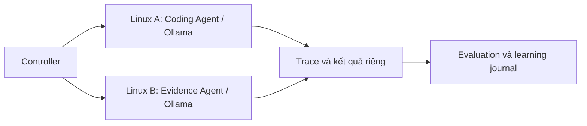

# LLM Agents Experiments — One-Year Hands-on Learning Lab

Đây là mini project cá nhân khoảng một năm: **hiểu nguyên lý → tự xây agent → làm mini-app → thử điều kiện khác → quan sát lỗi → đọc paper → cải thiện**. Mục tiêu là kinh nghiệm thực hành, không yêu cầu phát hiện khoa học mới hay công bố paper.

Repository duy nhất: [LLM-AGENTS-EXPERIMENTS](https://github.com/PhamNguyenMinhTam/LLM-AGENTS-EXPERIMENTS).

## Vì sao làm và mục tiêu một năm

Tự xây hệ thống nhỏ giúp phân biệt năng lực model với tác động của prompt, công cụ, bộ nhớ và phần cứng. Sau một năm, mục tiêu là vận hành hai agent nhỏ, giải thích được vòng đời nhiệm vụ, đọc trace để phân tích lỗi, thiết kế phép thử có đối chứng và liên kết mỗi bài đọc với một quan sát có bằng chứng. Đây là mục tiêu **Planned**, chưa phải kết quả đã đạt.

## Hiểu các thành phần

| Thành phần | Vai trò |
|---|---|
| LLM | Model sinh văn bản từ ngữ cảnh; chạy inference qua Ollama |
| Agent | Chương trình dùng model, trạng thái và chính sách để xử lý nhiệm vụ |
| Tool | Hành động có cấu trúc do runtime kiểm soát, ví dụ đọc tài liệu |
| Memory | Thông tin giữ lại để truy xuất; có thể cũ, sai hoặc nhiễm dữ liệu |
| Controller | Chọn cấu hình, giao task độc lập và đánh giá; không phải agent trao đổi với nhau |

## Hai laptop, hai agent độc lập



Ban đầu hai laptop dùng cùng loại CPU/chip. Mỗi máy chạy một LLM và một agent cho mini-domain riêng. Không có A2A, thương lượng, consensus hoặc belief aggregation engine. Codex hỗ trợ phát triển và kiểm thử. Sơ đồ mô tả đích triển khai; chưa xác minh hai laptop thật.

## mini-mOS và trạng thái thực tế

[mini_mos](mini_mos/README.md) là framework thực hành cá nhân, không tuyên bố sao chép kiến trúc nội bộ ChatGPT hay mOS có sẵn. Slice hiện tại: Task → Runtime → Ollama adapter cũ → Result → Trace → exact-match evaluation. Đổi model bằng YAML, không sửa mini-app.

| Thành phần | Trạng thái |
|---|---|
| Config, Ollama adapter, E01 runner, evaluator cũ | Implemented; kiểm thử mock |
| Runtime một bước, trace và CLI | Implemented; live cần Ollama được cấu hình |
| [Coding Agent](apps/coding_agent/README.md) | Scaffold; kiểm tra cú pháp tĩnh, chưa chạy code |
| [Knowledge & Evidence Agent](apps/evidence_agent/README.md) | Fixture/mock B01; chưa trích claim bằng LLM |
| Tools, persistent memory/RAG, feedback loop, belief revision | Planned |
| B02–B08 | Planned; có scenario và tiêu chí quan sát |

## Sáu learning tracks

Xem [bản đồ bài học](learning/learning_tracks.md) và [concept map](learning/concept_map.md).

| Track | Học qua thực hành |
|---|---|
| A — LLM Foundations | Ollama, model, context, sampling, quantization, giới hạn phần cứng; E01–E06 |
| B — Agent Engineering | Lifecycle, state, policy, tools, permissions, lỗi và dừng; E07–E10 |
| C — Practical Mini-Apps | Coding Agent, Evidence Agent, workflow, CLI và debugging |
| D — Memory & Adaptation | Retrieval, reflection, feedback, sửa lỗi và memory contamination; E11–E12 |
| E — Belief, Evidence & Verification | Claim, provenance, mâu thuẫn, dependency và verification; B01–B08 |
| F — Future Multi-Agent Preparation | Ghi nhận giới hạn một agent và câu hỏi tương tác; chỉ tài liệu |

## Mười hai experiment matrices

Giữ nguyên tên, config, runner, README, checklist, evaluation và 12 branch thí nghiệm. [Ma trận](experiments/experiment_matrix.md) tiếp tục là nền benchmark, không thay thế mini-app và learning journal.

| Nhóm | Experiments | Liên kết |
|---|---|---|
| Benchmark nền | E01 Baseline, E02 Model Type, E03 Hardware, E04 Model Size, E05 Quantization, E06 Hardware × Model | [Experiments](experiments/README.md) |
| Agent Engineering | E07 Domain, E08 Difficulty, E09 Prompt, E10 Tools | [Tracks](learning/learning_tracks.md) |
| Memory & Adaptation | E11 Memory, E12 Feedback | [Roadmap](ROADMAP.md) |

Không có benchmark thật mới trong lần refactor này. Can thiệp tools/memory/feedback E10–E12 vẫn bị chặn nếu chưa triển khai runtime.

## Đọc paper và khám phá belief/evidence

[Literature](literature/README.md) có registry và mẫu note; phân biệt báo cáo của tác giả, diễn giải cá nhân và quan sát thực hành. [Explorations](explorations/README.md) có B01 đúng nguồn, B02 sai nguồn, B03 mâu thuẫn, B04 trùng bằng chứng, B05 memory cũ, B06 sửa nguồn, B07 lan truyền dependency và B08 ngân sách xác minh. B01 chỉ chứng minh fixture plumbing, không chứng minh nguồn đúng ngoài đời.

## Roadmap và tiến độ

[ROADMAP](ROADMAP.md): Q1 foundations; Q2 practical agents; Q3 memory/adaptation; Q4 reliability và chuẩn bị tương lai. [LEARNING_CHECKLIST](LEARNING_CHECKLIST.md) theo dõi sản phẩm học; [checklist benchmark cũ](docs/experiment_checklist.md) giữ nguyên. Một quý là ba tháng kể từ lúc bắt đầu, không áp đặt năm lịch.

## Setup Linux

```bash
git clone https://github.com/PhamNguyenMinhTam/LLM-AGENTS-EXPERIMENTS.git
cd LLM-AGENTS-EXPERIMENTS
python3 -m venv .venv
source .venv/bin/activate
python -m pip install -r requirements.txt
cp .env.example .env
python -m pytest -q
python -m ruff check .
```

Giữ `.env` local. [Setup cũ và cấu hình hai laptop](docs/archive/README_before_one_year_lab.md) vẫn được bảo toàn. Cho live, điền endpoint LAN/VPN riêng cho A/B, exact model tag, digest, quantization và hardware ID trong config; không mở Ollama ra Internet. Dùng [hướng dẫn Ollama Linux](https://docs.ollama.com/linux) và metadata `/api/tags`; không đoán digest. Các file `configs/` là inventory; runner dùng YAML thí nghiệm được chọn.

## Chạy slice, mini-app và E01

Sau khi tạo `.env` từ mẫu, chạy offline:

```bash
python -m mini_mos.cli --config experiments/E01_baseline/config.yaml --mock-response 5 --trace results/raw/slice-mock.json
python -m apps.evidence_agent.app --fixture explorations/belief_formation/B01_correct_source/fixture.json
python -m apps.coding_agent.app --source apps/coding_agent/fixtures/example.py
python -m scripts.run_experiment --config experiments/E01_baseline/config.yaml --dry-run
```

Trace dùng chế độ tạo mới để tránh ghi đè: đổi tên nếu file đã tồn tại. `--mock-response` là dữ liệu giả lập được khai báo, không tự lấy expected answer làm phản hồi. Bỏ flag này chỉ khi đã điền cấu hình thật; CLI kiểm tra model trước gọi Ollama. Runtime chỉ chạy task đầu tiên; dùng E01 runner để đo đầy đủ:

```bash
python -m scripts.check_ollama --config experiments/E01_baseline/config.yaml
python experiments/E01_baseline/run.py
```

Kết quả benchmark: manifest, JSONL và CSV dưới `results/raw/`; trace slice là JSON riêng, không trộn với benchmark. Không commit raw logs, secrets hoặc model weights.

## Duy trì learning journal

Mỗi tuần sao chép mẫu trong [weekly_journal](learning/weekly_journal.md), ghi task/config/commit, điều đã test, lỗi và câu hỏi tiếp theo. Ghi nhận quan sát khác với giả thuyết giải thích. Không điền kết quả trước khi chạy. Xem [questions](learning/questions.md) và [lessons](learning/lessons_learned.md).

## Giới hạn và hướng tương lai

Chưa chạy Ollama/hai laptop thật trong lần tái cấu trúc. Exact-match không đánh giá code tổng quát. Coding app không thực thi code vì chưa có sandbox cô lập CPU/RAM/thời gian/mạng. Chưa có tool loop, persistent memory, retrieval hay kiểm chứng ngữ nghĩa. B01 kiểm tra quote, source ID, hash và nhãn fixture, không xác nhận sự thật.

[Future Multi-Agent](future_multi_agent/README.md) lưu candidate idea “Active Dependency Verification for Reliable Distributed Belief Aggregation in LLM-Based Multi-Agent Systems”. Đây chưa phải đề tài chốt hoặc kết quả được chứng minh. Chỉ xem xét bước đó sau [transition checklist](future_multi_agent/transition_checklist.md).

Thay đổi nền tảng trên `refactor/one-year-agent-lab`, PR vào `main`; không tự merge, không force push và không sửa 12 branch thí nghiệm. Các branch `dev/*` chỉ tạo khi có nội dung riêng cần phát triển.
