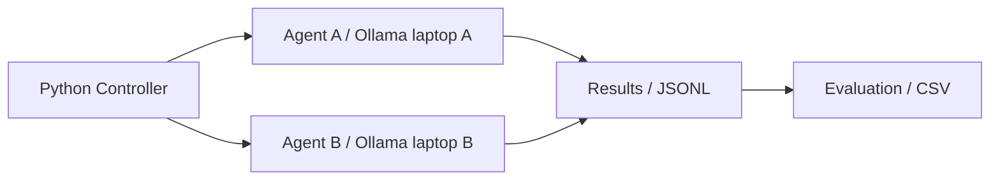

# LLM Agents Experiments

## Mục lục

- [Repository sử dụng](#repository-sử-dụng)
- [Giới thiệu và bối cảnh](#giới-thiệu-và-bối-cảnh)
- [Mục tiêu](#mục-tiêu)
- [Phạm vi và khái niệm](#phạm-vi-và-khái-niệm)
- [Kiến trúc và công nghệ](#kiến-trúc-và-công-nghệ)
- [Cấu trúc repository](#cấu-trúc-repository)
- [Mười hai ma trận và yếu tố thay đổi](#mười-hai-ma-trận-và-yếu-tố-thay-đổi)
- [Clone và cài đặt Ubuntu](#clone-và-cài-đặt-ubuntu)
- [Cấu hình laptop A/B](#cấu-hình-laptop-ab)
- [Chạy E01 và thí nghiệm khác](#chạy-e01-và-thí-nghiệm-khác)
- [Thu thập và đánh giá](#thu-thập-và-đánh-giá)
- [Lộ trình nghiên cứu](#lộ-trình-nghiên-cứu)
- [Checklist tiến độ](#checklist-tiến-độ)
- [Tiến độ và chiến lược branch](#tiến-độ-và-chiến-lược-branch)
- [Chuyển branch và cập nhật tiến độ](#chuyển-branch-và-cập-nhật-tiến-độ)
- [Hướng phát triển](#hướng-phát-triển)

## Repository sử dụng
Repository duy nhất: [PhamNguyenMinhTam/LLM-AGENTS-EXPERIMENTS](https://github.com/PhamNguyenMinhTam/LLM-AGENTS-EXPERIMENTS). Không tạo mới, không đổi tên hoặc tự thay visibility.

## Giới thiệu và bối cảnh
Dự án iTwin Lab 2026 đánh giá năng lực, hành vi, hiệu năng và khả năng thích nghi của LLM agent độc lập. Hai laptop Ubuntu, mỗi máy chạy một Ollama và một agent; Python Controller phân phối nhiệm vụ, lưu dữ liệu và đánh giá riêng từng agent. Ban đầu dùng cùng chip/model; sau đó thay có kiểm soát từng yếu tố.

## Mục tiêu
Khảo sát năng lực nhiệm vụ, hành vi và tuân thủ, hiệu năng phần cứng, chuyên môn hóa, thích nghi và tính tái lập. Hai chip cùng loại vẫn có thể khác hiệu năng do nguồn điện, nhiệt độ và cấu hình hệ thống. Đo độ ổn định; tách ảnh hưởng họ model, kích thước, quantization và phần cứng; khảo sát domain, độ khó, prompt; xây dựng protocol tools, memory và feedback có đối chứng. Xem [mục tiêu](docs/research_objectives.md) và [phương pháp](docs/methodology.md).

## Phạm vi và khái niệm
Không có giao tiếp A–B hoặc phối hợp multi-agent. Comparison là so sánh điều kiện; Adaptation là điều chỉnh trạng thái/chiến lược qua kinh nghiệm; Model Evolution đòi hỏi thay đổi model có cơ chế học và bằng chứng. Thay model, prompt hoặc chip không chứng minh tiến hóa.

## Kiến trúc và công nghệ

Không có kết nối trực tiếp giữa Agent A và Agent B. Codex hỗ trợ xây dựng mã, kiểm thử và bảo trì repository; không tham gia làm đối tượng đo.
Controller → Agent A / Ollama A và Controller → Agent B / Ollama B → evaluator → JSONL/CSV. Mỗi request độc lập, chỉ input được gửi đến model. Python ≥3.11, YAML/Pydantic, Git/GitHub Actions; mục tiêu triển khai Ubuntu. Xem [kiến trúc](docs/architecture.md).

## Cấu trúc repository
```text
agents/       base_agent.py, ollama_agent.py, roles/
controller/   config.py, experiment_runner.py, task_dispatcher.py
configs/      agents.yaml, hardware.yaml, models.yaml, evaluation.yaml
datasets/     coding/, mathematics/, classification/
evaluation/   metrics.py, evaluator.py, result_schema.py
experiments/  experiment_matrix.md, E01_baseline/ … E12_feedback/
results/      raw/, summary/, figures/
scripts/      setup_ubuntu.sh, check_environment.py, check_ollama.py, run_experiment.py
tests/        config, agent, metrics, schema, runner và structure
docs/         architecture, methodology, evaluation_guide, checklist, research_log, glossary
.github/      workflows/ci.yml, ISSUE_TEMPLATE/experiment.md
```
Mỗi E có README.md, CHECKLIST.md, EVALUATION.md, config.yaml, run.py và results/.gitkeep. [Cây đầy đủ](docs/tree.txt).

## Mười hai ma trận và yếu tố thay đổi
| ID | Yếu tố thay đổi | Cấu hình so sánh | Mục tiêu | Tài liệu |
|---|---|---|---|---|
| E01 | Baseline Stability | Cùng cấu hình, chạy lặp | Độ ổn định | [Kế hoạch](experiments/E01_baseline/README.md), [Checklist](experiments/E01_baseline/CHECKLIST.md), [Đánh giá](experiments/E01_baseline/EVALUATION.md) |
| E02 | Model Type | Qwen / Llama / Gemma | Năng lực model | [Kế hoạch](experiments/E02_model_type/README.md), [Checklist](experiments/E02_model_type/CHECKLIST.md), [Đánh giá](experiments/E02_model_type/EVALUATION.md) |
| E03 | Hardware | Chip X / Chip Y | Hiệu năng phần cứng | [Kế hoạch](experiments/E03_hardware/README.md), [Checklist](experiments/E03_hardware/CHECKLIST.md), [Đánh giá](experiments/E03_hardware/EVALUATION.md) |
| E04 | Model Size | 1B / 3B / 7B–8B | Ảnh hưởng kích thước | [Kế hoạch](experiments/E04_model_size/README.md), [Checklist](experiments/E04_model_size/CHECKLIST.md), [Đánh giá](experiments/E04_model_size/EVALUATION.md) |
| E05 | Quantization | Q4 / Q8 / FP16 | Đánh đổi chất lượng/tài nguyên | [Kế hoạch](experiments/E05_quantization/README.md), [Checklist](experiments/E05_quantization/CHECKLIST.md), [Đánh giá](experiments/E05_quantization/EVALUATION.md) |
| E06 | Hardware × Model | Các tổ hợp chip–model | Tương tác phần cứng và model | [Kế hoạch](experiments/E06_hardware_model/README.md), [Checklist](experiments/E06_hardware_model/CHECKLIST.md), [Đánh giá](experiments/E06_hardware_model/EVALUATION.md) |
| E07 | Domain | Generalist / Specialist | Chuyên môn hóa | [Kế hoạch](experiments/E07_domain/README.md), [Checklist](experiments/E07_domain/CHECKLIST.md), [Đánh giá](experiments/E07_domain/EVALUATION.md) |
| E08 | Task Difficulty | Easy / Medium / Hard | Giới hạn năng lực | [Kế hoạch](experiments/E08_difficulty/README.md), [Checklist](experiments/E08_difficulty/CHECKLIST.md), [Đánh giá](experiments/E08_difficulty/EVALUATION.md) |
| E09 | Prompt Strategy | Zero-shot / Few-shot / Structured | Ảnh hưởng prompt | [Kế hoạch](experiments/E09_prompt/README.md), [Checklist](experiments/E09_prompt/CHECKLIST.md), [Đánh giá](experiments/E09_prompt/EVALUATION.md) |
| E10 | Tool Access | No Tool / Tool-enabled | Lợi ích công cụ | [Kế hoạch](experiments/E10_tools/README.md), [Checklist](experiments/E10_tools/CHECKLIST.md), [Đánh giá](experiments/E10_tools/EVALUATION.md) |
| E11 | Memory | None / Short-term / Long-term | Khả năng sử dụng kinh nghiệm | [Kế hoạch](experiments/E11_memory/README.md), [Checklist](experiments/E11_memory/CHECKLIST.md), [Đánh giá](experiments/E11_memory/EVALUATION.md) |
| E12 | Feedback | None / Binary / Detailed | Khả năng sửa lỗi | [Kế hoạch](experiments/E12_feedback/README.md), [Checklist](experiments/E12_feedback/CHECKLIST.md), [Đánh giá](experiments/E12_feedback/EVALUATION.md) |


## Clone và cài đặt Ubuntu
```bash
git clone https://github.com/PhamNguyenMinhTam/LLM-AGENTS-EXPERIMENTS.git
cd LLM-AGENTS-EXPERIMENTS
```
```bash
bash scripts/setup_ubuntu.sh
source .venv/bin/activate
cp .env.example .env
python -m scripts.check_environment
python -m pytest -q
```
Cài Ollama theo [hướng dẫn Linux chính thức](https://docs.ollama.com/linux), tải tag phù hợp ngân sách RAM/VRAM. Kiểm tra [API chat](https://docs.ollama.com/api/chat) và [metadata model](https://docs.ollama.com/api/tags). Không tự đoán digest/quantization.

## Cấu hình laptop A/B
Điền endpoint A/B khác nhau trong `.env`, model tag chính xác, digest và quantization từ `/api/tags`; hardware ID liên kết inventory `configs/hardware.yaml`. Hai endpoint localhost trong mẫu chỉ để phát triển; hai laptop cần địa chỉ LAN/VPN thực tế. Chỉ cho controller truy cập Ollama qua mạng tin cậy/firewall; không mở API ra Internet.
Giữ cùng inference parameters, model digest, prompt và dataset cho E01. Với điều kiện model khác nhau, sửa từng agent trong bản sao YAML. Bốn file configs/ là inventory tham khảo; runner chỉ nạp config thí nghiệm được chọn. Prompt role là thư viện; YAML giữ nguyên văn prompt chạy thật.

## Chạy E01 và thí nghiệm khác
```bash
python -m scripts.run_experiment --config experiments/E01_baseline/config.yaml --dry-run
python -m scripts.check_ollama --config experiments/E01_baseline/config.yaml
python experiments/E01_baseline/run.py
```
Cần `pip install -r requirements.txt` trước khi chạy wrapper. Thay đường dẫn E để chọn thí nghiệm. Dry-run cần biến môi trường đầy đủ nhưng chấp nhận placeholder, không gọi API và không ghi kết quả. Live từ chối placeholder và kiểm tra tag/digest/quantization trước đo.
Đối chiếu [ma trận](experiments/experiment_matrix.md), sao chép config theo điều kiện, đặt condition riêng. E10–E12 có control chạy được, nhưng can thiệp tools/memory/feedback **chưa triển khai** và bị chặn bằng lỗi rõ ràng.

## Thu thập và đánh giá
Mỗi run lưu manifest (config resolve, dataset SHA256, commit, dirty flag), JSONL từng task và CSV từng agent ở `results/raw/E##/<run_id>/`. Không commit raw logs hoặc dữ liệu nhạy cảm. Expected output chỉ dùng evaluator, không đưa vào request. Exact-match là scorer MVP; coding tổng quát cần sandbox/test suite chưa có.
Resource metrics, energy và TTFT chưa đo, ghi null; metrics định tính cần rubric và người chấm. Xem [hướng dẫn](docs/evaluation_guide.md) và từng EVALUATION.md. Không có kết quả benchmark thật trong repository; smoke task chỉ kiểm tra luồng.

## Lộ trình nghiên cứu
| Giai đoạn | Nội dung | Điều kiện chuyển bước |
|---|---|---|
| Phase 0 | Repository và môi trường | Lint/tests đạt, hai endpoint được xác minh |
| Phase 1 | Baseline E01 | Có dữ liệu lặp hợp lệ và sai số được báo cáo |
| Phase 2 | Model và phần cứng E02–E06 | Cấu hình ghép cặp, đủ ô so sánh hoặc ghi không khả thi |
| Phase 3 | Domain và hành vi E07–E10 | Dataset/rubric chuẩn hóa, tool trace nếu bật công cụ |
| Phase 4 | Adaptation E11–E12 | Runtime can thiệp và tách development/final được kiểm chứng |
| Phase 5 | Đánh giá và báo cáo | Có CI thống kê, phân tích lỗi và hồ sơ tái lập |

## Checklist tiến độ
- [x] Tạo framework local và đủ bộ tài liệu E01–E12.
- [x] Kiểm thử mock/dry-run không phụ thuộc GPU.
- [x] Push và xác minh đủ 13 remote branch.
- [x] Xác minh GitHub Actions chạy lint/tests trên main.
- [ ] Cài và xác minh hai laptop Linux/Ollama.
- [ ] Khóa dataset nghiên cứu và rubric.
- [ ] Chạy baseline E01 thật và lưu dữ liệu.
- [ ] Thực hiện E02–E10 theo điều kiện kiểm soát.
- [ ] Triển khai rồi đánh giá memory/feedback E11–E12.
- [ ] Hoàn thành phân tích thống kê và báo cáo.

## Tiến độ và chiến lược branch
[Checklist tổng](docs/experiment_checklist.md) và các checklist trong bảng trên theo dõi chuẩn bị, thực thi, đánh giá, hoàn thành. Không đánh dấu hoàn thành khi chưa có bằng chứng.
Main chứa nền tảng; 12 branch `experiment/e##-...` tạo trực tiếp từ main, có commit kế hoạch điều kiện riêng và không merge ngược. Cập nhật nền tảng trên main trước, sau đó tích hợp có kiểm soát. Xem [biên bản kiểm tra](docs/verification.md).

## Chuyển branch và cập nhật tiến độ
```bash
git fetch origin
git switch experiment/e03-hardware
python -m scripts.run_experiment --config experiments/E03_hardware/config.yaml --dry-run
git switch main
```
Đánh dấu checklist tương ứng khi đã có bằng chứng; ghi ngày, run_id, commit/config/checksum và hạn chế vào `docs/research_log.md`. Chạy `python -m ruff check .` và `python -m pytest -q` trước commit. Không merge branch thí nghiệm về main nếu chưa có yêu cầu.

## Hướng phát triển
Chuẩn bị benchmark development/final có license; triển khai collector trên inference host; streaming TTFT; coding sandbox; tool loop có allowlist; memory tách session và feedback có trace; phân tích bootstrap/Pareto và biểu đồ. Chỉ mở rộng sang phối hợp agent khi có thiết kế nghiên cứu mới.

Multi-Agent Communication chỉ xem xét ở giai đoạn sau với thiết kế nghiên cứu riêng; không thuộc Phase 1.
