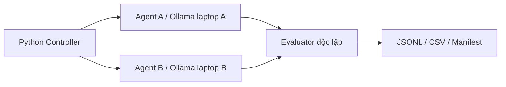

# Kiến trúc

Không có đường A–B. Mỗi request có system prompt và một input riêng, không tái sử dụng chat history. Controller chạy tuần tự và xáo trộn thứ tự cố định seed 42; không đo tải đồng thời.
Agent chỉ nhận input, evaluator giữ expected_output. Mỗi agent chỉ có một endpoint; kiểm tra endpoint A/B khác nhau.
MVP là agent thực thi một lượt, chưa có planning loop, tool loop, memory hay feedback. Chưa có cơ chế kiểm soát mạng trên máy vật lý; cần triển khai firewall nếu đòi hỏi cô lập hạ tầng.
Preflight kiểm tra tag/digest/quantization cho từng endpoint. Lỗi preflight dừng run; lỗi request được ghi error_type và điểm 0, không retry âm thầm.
