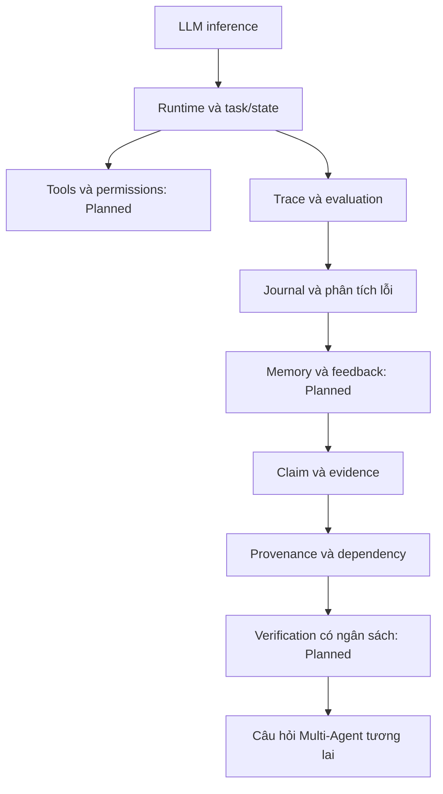

# Concept map

Model sinh câu trả lời không tự bảo đảm hành động đúng; runtime phải kiểm soát hành động. Memory không phải sự thật; provenance giúp truy nguyên, chưa chứng minh nguồn đúng. Các mũi tên là quan hệ học tập, không phải module đã hoàn tất.
